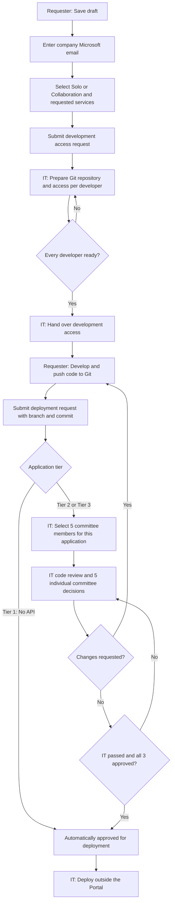

# Application request flow

The Portal records development preparation and deployment approval. IT performs actual deployment separately.

## Persistent process indicator

Draft → IT preparation → Development → Deployment review → Approved.
The request detail page shows the current step and the next responsible party throughout the page.
Approval means approved for deployment; it does not confirm that the application has been deployed.

## Scope

- IT preparation records readiness per named developer. It does not automatically create repositories, grant collaboration permissions, or send email.
- API credentials: completing IT preparation issues a **Sandbox** Token ID/Secret for requests that include APIs, so the requester can develop against the Gateway. Approval issues the **Production** credential. Suspension revokes both. The rule lives in `ApplicationWorkflow.CredentialAllowed`; see `docs/gateway.md`.
- Company email collection does not verify a Microsoft identity. SSO remains deferred.
- Collaboration lists the requested developer accounts; it does not grant them Portal ownership or editing rights.
- Committee: each application has its own committee of five people (`Applications.CommitteeSize`; requests that existed before migration `CommitteeSizePerApplication` keep three). Every member must approve. IT selects them on the request card in Requests and reviews and can replace anyone at any time. The requester cannot review their own request. Replacing a member during a review discards that member's decision for the current cycle; the new member must decide. Rules live in `ApplicationWorkflow.SetReviewersAsync`.
- Existing requests keep their original approval history. Earlier preparation steps are marked as unrecorded.
- New deployment requests retain their branch and commit, and use a new review cycle after changes are requested.
- IT code review can include up to five supporting https:// links (for example SharePoint or OneDrive). The Portal stores links only, not files. IT can withdraw its code review decision while the request is still under review.

- IT re-review records resolution on each original change-request round: resolving cycle, approving administrator email, and timestamp. Before passing, IT explicitly confirms all outstanding IT change-request rounds, including requests made by other administrators. Later rounds retain earlier resolutions. IT can pass selected change-request rounds independently without passing the overall IT review. Withdrawing the overall approval preserves every item-level pass and its original administrator/timestamp. Legacy records remain unconfirmed until explicitly checked; no historical passes are inferred. Schema: `20261104090000_TrackITChangeResolution` (applied by API startup migrations).

- After committee and IT approvals, development requests appear in the admin deployment queue as Awaiting deployment. Admins record Deployed, then Live; each transition retains its administrator and timestamp in DevelopmentJson and the activity log. These actions record deployment completion; they do not execute a deployment. Existing active development requests with no deployment record remain Awaiting deployment. No additional database columns are required.

- Live systems can request an update with version, change summary, branch and commit. Each update is a separate linked review request, with the same owner and committee; the original system stays live with its existing credentials. Only one update can be in progress. When the update goes live, the original application records the new release and retains the full release history with links to each request's review and deployment records. This uses DevelopmentJson and requires no schema migration.

- Update requests cannot issue or regenerate separate Sandbox/Production credentials, including reactivation; manage credentials on the main application. Deployment status writes require the screen's ExpectedUpdatedAt and use UpdatedAt as an EF concurrency token, including updates to the main application when an update goes live. Stale writes return HTTP 409 and refresh the admin list. The ProtectApplicationUpdates migration updates EF metadata only; it adds no database columns.
