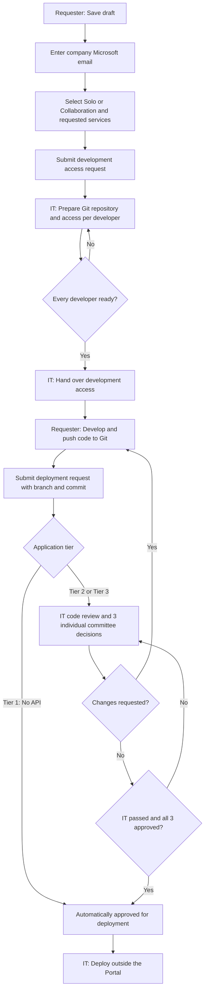

# Application request flow

The Portal records development preparation and deployment approval. IT performs actual deployment separately.

## Persistent process indicator

Draft → IT preparation → Development → Deployment review → Approved.
The request detail page shows the current step and the next responsible party throughout the page.
Approval means approved for deployment; it does not confirm that the application has been deployed.

## Scope

- IT preparation records readiness per named developer. It does not automatically create repositories, grant collaboration permissions, or send email.
- API credentials: completing IT preparation issues a **Sandbox** Token ID/Secret for requests that include APIs, so the requester can develop against the Gateway. Approval issues the **Production** credential. Suspension revokes both. The rule lives in `ApplicationWorkflow.CredentialAllowed`; see `docs/gateway.md`.
- Company email collection does not verify a Microsoft identity. SSO remains deferred.
- Collaboration lists the requested developer accounts; it does not grant them Portal ownership or editing rights.
- Committee account assignments remain separate. The final policy for selecting approvers is still undecided.
- Existing requests keep their original approval history. Earlier preparation steps are marked as unrecorded.
- New deployment requests retain their branch and commit, and use a new review cycle after changes are requested.
