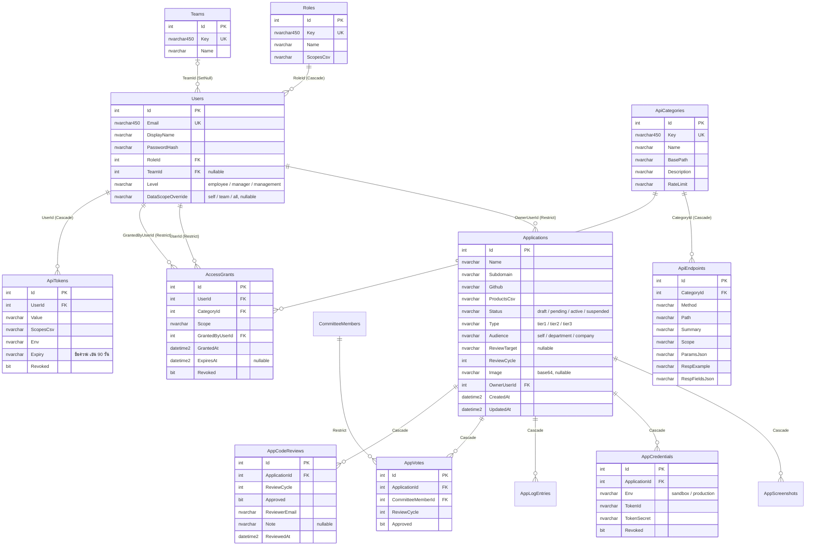

# โครงสร้างฐานข้อมูล MGT Portal

สรุปจากโค้ดใน `src/Api/MGT.Portal.Api` (entity + `PortalDbContext` + migration ล่าสุด `20261016150000_TiersCodeReviewAudience`)
ฐานข้อมูลเป็น SQL Server มี 14 ตาราง อยู่ใน schema `dbo` ทั้งหมด และมี `__EFMigrationsHistory` ของ EF Core อีก 1 ตาราง

> migration `TiersCodeReviewAudience` เพิ่มตาราง `AppCodeReviews`, คอลัมน์ `Applications.Audience` และแปลงค่าระดับเดิม (registered / verify / official) เป็น tier1 / tier2 / tier3 ให้อัตโนมัติตอนแอปเริ่ม

## ตารางแบ่งตาม module

| Module | ตาราง | entity (ไฟล์) | หน้าที่ |
|---|---|---|---|
| Identity | `Users` | `Modules/Identity/Domain/User.cs` | ผู้ใช้, รหัสผ่าน (BCrypt), ระดับองค์กร, ขอบเขตข้อมูล |
| Identity | `Roles` | `Modules/Identity/Domain/Role.cs` | บทบาทและ scope ที่ได้ (`*` = admin) |
| Identity | `Teams` | `Modules/Identity/Domain/Team.cs` | ทีม ใช้กำหนดว่า Manager เห็นข้อมูลของใคร |
| Catalog | `ApiCategories` | `Modules/Catalog/Domain/ApiCategory.cs` | หมวด API (sales, purchase, ...) |
| Catalog | `ApiEndpoints` | `Modules/Catalog/Domain/ApiEndpoint.cs` | endpoint ในแต่ละหมวด พร้อมตัวอย่าง request/response |
| Apps | `Applications` | `Modules/Apps/Domain/Application.cs` | คำขอ/ทะเบียน App |
| Apps | `AppScreenshots` | 〃 | รูปหน้าจอของ App (base64) |
| Apps | `AppCredentials` | 〃 | Token ID / Secret ของ App แยก sandbox / production |
| Apps | `AppLogEntries` | 〃 | ประวัติการเปลี่ยนแปลงของ App |
| Apps | `AppVotes` | 〃 | คะแนนโหวตของกรรมการต่อรอบการรีวิว |
| Apps | `AppCodeReviews` | 〃 | ผล IT code review ต่อรอบการรีวิว (Tier 2/3) |
| Apps | `CommitteeMembers` | `Modules/Apps/Domain/CommitteeMember.cs` | รายชื่อคณะกรรมการ |
| Access | `AccessGrants` | `Modules/Access/Domain/AccessGrant.cs` | สิทธิ์เพิ่มเติมที่ admin ให้ผู้ใช้รายคน มีวันหมดอายุ |
| Access | `ApiTokens` | `Modules/Access/Domain/ApiToken.cs` | token ส่วนตัวที่ผู้ใช้สร้างจากหน้า "Token ของฉัน" |

การตั้งค่าความสัมพันธ์และ index ของแต่ละ module อยู่ที่ `Modules/<Module>/Persistence/*Configuration.cs`

## ความสัมพันธ์ (ER diagram)



ภาพเดียวกันแบบความละเอียดสูง (ซูมได้ไม่แตก): [database-er.svg](database-er.svg)

ตารางที่ไม่ได้แสดงคอลัมน์ในแผนภาพ: `AppScreenshots` (ImageData, SortOrder), `AppLogEntries` (ActionType, OccurredAt, Actor, Note), `CommitteeMembers` (Name, RoleTitle)

## Index และข้อบังคับ

| ตาราง | Index | Unique |
|---|---|---|
| `Users` | `Email` | ✓ |
| `Users` | `RoleId`, `TeamId` | |
| `Roles` | `Key` | ✓ |
| `Teams` | `Key` | ✓ |
| `ApiCategories` | `Key` | ✓ |
| `AppVotes` | (`ApplicationId`, `CommitteeMemberId`, `ReviewCycle`) | ✓ กรรมการ 1 คนโหวตได้ 1 ครั้งต่อรอบ |
| `AppCodeReviews` | (`ApplicationId`, `ReviewCycle`) | ✓ IT รีวิวได้ 1 ผลต่อรอบ |
| `AccessGrants` | (`UserId`, `Revoked`) | |
| ตารางลูกทุกตัว | คอลัมน์ FK | |

## ความสัมพันธ์ข้าม module

ตอนนี้ทุก module ใช้ `PortalDbContext` ตัวเดียว จึงยังมี FK ข้าม module อยู่ 5 เส้น:

| จาก | ไป | หมายเหตุ |
|---|---|---|
| `Applications.OwnerUserId` | `Users` | Apps → Identity |
| `AccessGrants.UserId`, `GrantedByUserId` | `Users` | Access → Identity |
| `AccessGrants.CategoryId` | `ApiCategories` | Access → Catalog |
| `ApiTokens.UserId` | `Users` | Access → Identity |

ทิศทางทั้งหมดชี้เข้า Identity หรือ Catalog ซึ่งตรงกับกติกาใน `tests/MGT.Portal.ArchitectureTests`
เมื่อจะแยก schema ต่อ module (ขั้นที่ 2) ให้เปลี่ยน FK เหล่านี้เป็นการเก็บแค่ Id แล้วถามผ่าน interface ของ module ปลายทาง

## จุดที่ควรปรับ (เรียงจากสำคัญมากไปน้อย)

1. **Secret เก็บเป็นข้อความธรรมดา** — `AppCredentials.TokenSecret` และ `ApiTokens.Value` ควรเก็บเป็น hash และแสดงให้ผู้ใช้เห็นครั้งเดียวตอนสร้าง
2. **ลบ Role แล้วผู้ใช้หายตาม** — `Users.RoleId` เป็น `Cascade` ควรเป็น `Restrict`
3. **ผู้ใช้ที่ไม่มีทีมเห็นข้อมูลทั้งหมด** — `DbSeeder.BackfillUnassignedUsersToSeeAll` ตั้ง `DataScopeOverride = all` ให้ทุกคนที่ยังไม่มีทีมทุกครั้งที่แอปเริ่ม ควรยืนยันว่าตั้งใจแบบนี้
4. **รูปภาพเก็บเป็น base64 ในตาราง** — `Applications.Image`, `AppScreenshots.ImageData` ทำให้ DB โตเร็วและ query ช้า ควรย้ายไป Azure Blob Storage แล้วเก็บแค่ URL
5. **ข้อมูลแบบ CSV** — `Applications.ProductsCsv`, `Roles.ScopesCsv`, `ApiTokens.ScopesCsv` ค้นหาและผูก FK ไม่ได้ ควรแยกเป็นตารางเชื่อม เช่น `ApplicationProducts (ApplicationId, CategoryId)`
6. **วันหมดอายุของ token เป็นข้อความ** — `ApiTokens.Expiry` เก็บ "90 วัน" ระบบจึงบังคับหมดอายุไม่ได้ ควรเป็น `ExpiresAt datetime2`
7. **คอลัมน์สถานะเป็น `nvarchar(max)`** — `Status`, `Type`, `Env`, `Level` ทำ index ไม่ได้ ควรกำหนดความยาว เช่น `nvarchar(32)` และใส่ check constraint
8. **กรรมการไม่ผูกกับผู้ใช้** — `CommitteeMembers` ไม่มี `UserId` ตอนนี้ admin โหวตแทนกรรมการคนไหนก็ได้ ควรผูกกับ `Users` แล้วให้กรรมการโหวตเอง
9. **ไม่มีการป้องกันแก้ข้อมูลพร้อมกัน** — `Applications` ควรมีคอลัมน์ `RowVersion` (concurrency token) เพราะโหวตหลายคนพร้อมกันได้
10. **ทุกตารางอยู่ใน `dbo`** — ขั้นที่ 2 ของ modular monolith คือแยก schema `identity`, `catalog`, `apps`, `access`
11. **`Users.PasswordHash`** — จะเลิกใช้เมื่อเปลี่ยนไป login ด้วย Entra ID (SSO)

ทุกข้อด้านบนต้องสร้าง migration ใหม่ ยังไม่ได้แก้ในรอบนี้

## วิธีเพิ่ม/แก้ตาราง

1. แก้ entity ใน `Modules/<Module>/Domain/` และการตั้งค่าใน `Modules/<Module>/Persistence/`
2. ถ้าเป็นตารางใหม่ เพิ่ม `DbSet` ใน `Infrastructure/Persistence/PortalDbContext.cs`
3. สร้าง migration (รันจากโฟลเดอร์ root ของ repo):
   ```
   dotnet ef migrations add <ชื่อ> --project src/Api/MGT.Portal.Api --output-dir Infrastructure/Persistence/Migrations
   ```
4. รันแอป — `Program.cs` เรียก `Database.Migrate()` ให้อัตโนมัติ
